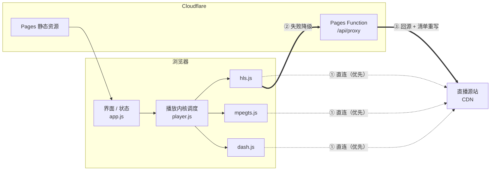

# qifeilive · 多画面直播墙

在一个屏幕里同时看多路网络直播。粘贴地址即播，自动识别协议，跨域被拦时自动降级走代理。

| | |
|---|---|
| **线上地址** | https://qifeilive.com （`www.qifeilive.com` 同样可用） |
| **备用地址** | https://qflive.pages.dev |
| **仓库** | https://github.com/oldbaiyang/qflive |
| **技术栈** | 原生 JS + hls.js / mpegts.js / dash.js，Cloudflare Pages + Pages Functions |
| **代码规模** | 约 2000 行手写代码，播放内核本地化，运行时不依赖任何 CDN |

---

## 1. 这个项目解决什么

看多个直播源时，通常是开一堆浏览器标签页，各自卡顿、各自出声、切换麻烦。这个工具做三件事：

1. **一个屏幕看多路** —— 1/2/4/6/9 宫格同屏，可自定义布局
2. **粘贴地址就能播** —— 不用管是 m3u8 还是 flv，自动选对播放内核
3. **跨域被拦也能播** —— 自带一个边缘代理，直连失败时自动切换

它是**纯工具**：不存储、不索引、不分发任何内容，源地址只存在你自己的浏览器里。

---

## 2. 功能

**播放**

- 协议自动识别：HLS / HTTP-FLV / MPEG-TS / DASH / MP4
- 布局 1 / 2 / 4 / 6 / 9 宫格，或按源数量自动排布
- 单画面操作：静音、独奏（只留这一路声音）、全屏、重载、移除
- 顶栏批量操作：全部静音、全部重载、整页全屏
- 断流自动重连，卡死自动拉起（12 秒防抖，避免无限重试）

**频道管理**

- 拖动列表项排序，双击改名
- 导入 `.m3u` / `.m3u8` / `.txt` / `.json` 播放列表，也可以直接把文件拖到画面区
- 导出为 m3u
- 配置存 `localStorage`（键 `qflive.v1`），刷新不丢

**网络**

- **直连优先**：先让播放器直接拉源，不消耗代理
- 直连失败或跨域被拒时，**自动降级**到本站 `/api/proxy` 重试一次，画面角标会标出「代理」
- 可手动开启「所有源强制走代理」，或填自定义代理前缀

---

## 3. 支持的协议

| 协议 | 典型后缀 | 能播 | 说明 |
|---|---|---|---|
| HLS | `.m3u8` | ✅ | 主力格式，走 hls.js（Safari 走原生） |
| HTTP-FLV | `.flv` | ✅ | 国内低延迟直播常用，走 mpegts.js |
| MPEG-TS | `.ts` | ✅ | 裸流，走 mpegts.js |
| DASH | `.mpd` | ✅ | 走 dash.js |
| MP4 / WebM | `.mp4` `.webm` | ✅ | 原生 `<video>` |
| RTMP | `rtmp://` | ❌ | 浏览器不支持，需 ffmpeg 转 HLS/FLV |
| RTSP | `rtsp://` | ❌ | 摄像头/NVR 常用，需转码 |
| SRT / UDP / RTP / MMS | `srt://` 等 | ❌ | 传输层协议，浏览器无法直接播放 |

识别不到后缀时按 HLS 尝试（多数直播 CDN 的默认形态）。不可播的协议会直接在画面上给出对应的 ffmpeg 转换命令。

---

## 4. 快速开始

需要 Node 18+。

```bash
git clone git@github.com:oldbaiyang/qflive.git
cd qflive
npm install
npm run dev          # http://localhost:8788
```

`npm run dev` 会先构建 `dist/`，再同时启动静态资源和 Pages Function，代理可用，和线上环境一致。

> 直接双击 `index.html` 或用 `python3 -m http.server` 也能看界面，但 `/api/proxy` 不存在，
> 跨域受限的源会播不出来（页面会提示）。此时可以在「设置」里填一个外部代理前缀。

---

## 5. 架构



**为什么需要这层代理**：浏览器直连第三方流要过 CORS。很多源不放行 `Access-Control-Allow-Origin`，
还有些校验 `Referer` 防盗链。代理替浏览器去拉，再把内容吐回来。

**但直连优先**是关键设计：国内大部分公开源其实放行跨域，先试直连能省掉绝大部分代理请求
（按 4 秒一个分片算，1 路 1 小时就是 900 次请求）。

---

## 6. 目录结构

```
index.html                页面骨架
assets/
  styles.css              深色主题样式
  app.js                  界面渲染、状态管理、直连→代理降级（约 850 行）
  player.js               协议识别 + 多内核调度（约 370 行）
functions/api/proxy.js    CORS 代理 + m3u8 重写 + SSRF 防护（约 190 行）
scripts/build.mjs         生成纯净的 dist/，避免把 node_modules 传上去
vendor/                   hls.js 1.5.17 / mpegts.js 1.7.3 / dash.js 4.7.4（本地化）
_routes.json              只让 /api/* 走 Function，静态资源不消耗函数额度
.github/workflows/        push 即自动部署
```

`vendor/` 总计约 1.4MB，只在真正需要某个内核时才动态加载（`player.js` 里的 `loadScript`），
所以首屏只加载页面本身。

---

## 7. 代理 API

### `GET /api/proxy?url=<encoded>[&ref=<encoded>]`

| 参数 | 必填 | 说明 |
|---|---|---|
| `url` | 是 | 目标地址，必须 URL 编码，仅允许 `http:` / `https:` |
| `ref` | 否 | 自定义 `Referer`，默认用目标站首页，用于绕过防盗链 |

### `GET /api/proxy?probe=1`

健康探测，返回纯文本 `ok`。前端用它判断当前环境有没有代理能力。

### 错误码

| 状态 | 含义 |
|---|---|
| 400 | 缺 `url`、URL 非法、或非 http/https |
| 403 | 目标命中内网地址黑名单（SSRF 防护） |
| 405 | 非 GET / HEAD |
| 413 | 清单超过 4MB |
| 502 | 回源失败（超时 20s） |

### 实现要点

**① 必须重写清单内容，光转发没用**

HLS 清单里写的是相对路径分片（`seg-1.ts`）。只代理 `x.m3u8`、不重写内容的话，播放器解析后
仍然会去源站拉分片，跨域照样被拦。所以代理会读回清单文本，把所有 URI 改写成
`/api/proxy?url=<绝对地址>`，覆盖：

- 普通行（分片、子清单）
- `#EXT-X-KEY` / `#EXT-X-MAP` / `#EXT-X-MEDIA` / `#EXT-X-I-FRAME-STREAM-INF` 里的 `URI="..."`

**② SSRF 防护**

拒绝 `localhost`、`*.local`、`*.internal`、`::1`、`fe80::/10`、`fc00::/7`，
以及 IPv4 的 `0/8`、`10/8`、`127/8`、`169.254/16`、`172.16/12`、`192.168/16`、
`100.64/10`、`198.18/15`、`224/4`（含组播和保留段）。否则这个站会变成别人探测内网的跳板。

**③ 不透传 `Content-Length`**

Cloudflare Workers 会自动解压上游响应，长度对不上会导致播放器截断。只透传
`Content-Type` / `Content-Range` / `Accept-Ranges` / `Last-Modified`，`Range` 请求头会往下透传，
所以 206 分段请求正常。

---

## 8. 部署

线上是 Cloudflare Pages 项目 `qflive`，生产分支 `main`。

### 自动部署（当前方式）

仓库已配好 GitHub Actions，**push 到 `main` 就自动上线**：

```bash
git push origin main
```

流程：`npm run build` → `wrangler pages deploy dist`。

> 为什么不用 Cloudflare 官方的「连仓库自动构建」：项目最初是 API 创建的**直接上传（Direct Upload）**
> 类型，Cloudflare 不允许事后改 `source`（报 `8000069`），只能新建项目。用 Actions 更省事。

### 手动部署

```bash
npx wrangler login     # 首次授权，token 约 1 小时过期
npm run deploy         # build + 上传
```

### 需要的 Secrets

| Name | 说明 |
|---|---|
| `CLOUDFLARE_API_TOKEN` | 权限：Account → Cloudflare Pages → Edit、Account Settings → Read、Zone → DNS → Edit、Zone → Zone → Read |
| `CLOUDFLARE_ACCOUNT_ID` | Dashboard 右下角 |

没配 secret 时 workflow 会跳过并给出提示，不会产生失败构建。

### 自定义域名

`qifeilive.com` 的 DNS 在 Cloudflare 托管：

| 类型 | 名称 | 目标 | 代理 |
|---|---|---|---|
| CNAME | `qifeilive.com` | `qflive.pages.dev` | ✅ |
| CNAME | `www.qifeilive.com` | `qflive.pages.dev` | ✅ |

裸域用的是 Cloudflare 的 CNAME 展平（flattening），证书由 Pages 自动签发并续期。
目前 `www` 和裸域各自独立可访问，**没有做互相跳转**。

---

## 9. 资源与配额

| 项目 | 说明 |
|---|---|
| Pages 静态请求 | 免费不限量 |
| Pages Functions | 免费 10 万次/天；超出需 Workers Paid（$5/月，1000 万次/月） |
| 请求量估算 | HLS 4 秒一个分片，1 路 1 小时 ≈ 900 次 |
| 端口限制 | Cloudflare 只能回源 80/443，源站在 `:8080` 之类端口的拉不到 |
| 源站封锁 | 少数国内 CDN 封 Cloudflare 回源 IP，遇到只能自建 VPS 兜底 |

参考：20 路 × 10 个用户 × 2 小时 ≈ 36 万次请求，会超出免费额度。靠「直连优先」可以压掉大部分。

---

## 10. 已知限制

- **RTMP / RTSP 不能播**：浏览器内核不支持，需先用 ffmpeg 转 HLS 或 FLV
- **加密流（DRM）无法播放**：`#EXT-X-KEY` 的 URI 会被改写，但 DRM 许可证链路不在代理范围内
- **需要登录态的源不支持**：代理不带 Cookie
- **非 80/443 端口**：Cloudflare 回源限制
- **同屏路数受解码能力限制**：16 路 1080p 软解会掉帧，建议不超过 9 路

---

## 11. 后续可以做的

按价值排序，都还没做：

1. **频道库分组 / 收藏** —— 源多了之后平铺列表不够用
2. **轮巡模式** —— 定时自动切换画面，适合监控大屏
3. **录制 / 截图** —— 单路录 webm、一键截图
4. **每路状态面板** —— 分辨率、码率、实际延迟
5. **DASH 按需加载** —— 目前 `dash.all.min.js` 有 775KB，虽然懒加载但仍偏重

---

## 12. 变更记录

| 日期 | 内容 |
|---|---|
| 2026-10-28 | 绑定 `qifeilive.com`；品牌字标改为 `qifeilive` / `QL`；打通 CI 自动部署 |
| 2026-10-27 | 代码上传 GitHub，加 GitHub Actions workflow |
| 2026-10-24 | MVP 完成并部署到 Cloudflare Pages：多画面播放、协议识别、代理与清单重写 |

---

## 免责

本工具只做播放，不存储、不索引、不分发任何内容。请只添加你有权观看的直播源。
